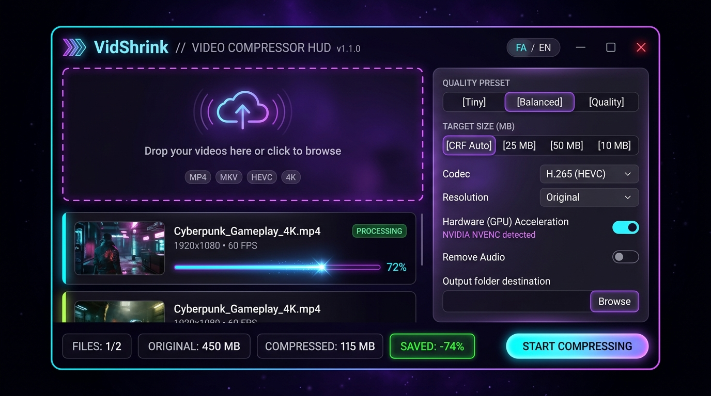
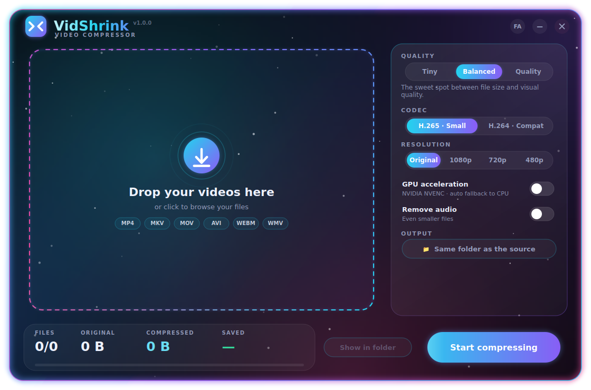
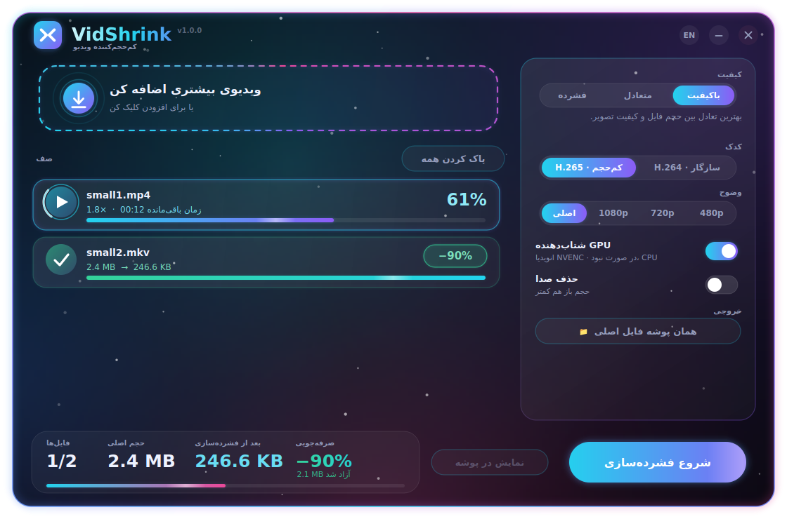

<div align="center">


# VidShrink

**A glowing, animated Windows video compressor.** Drag. Drop. Shrink.

[](https://github.com/YOUR_USER/VidShrink/actions)


[](https://github.com/YOUR_USER/VidShrink/releases)



</div>

## ✨ Features

- **Drag & drop** files or entire directories, batch queue with live progress, speed, and real-time ETA.
- **Hardware Acceleration (Auto GPU)** – Intelligently detects and utilizes:
  - **NVIDIA NVENC** (`hevc_nvenc`, `h264_nvenc`)
  - **Intel QuickSync** (`hevc_qsv`, `h264_qsv`)
  - **AMD AMF** (`hevc_amf`, `h264_amf`)
  - Seamless automatic fallback to CPU if GPU encoding is unavailable.
- **Target File Size Mode** – Instant presets for sharing:
  - **Discord** (25 MB limit)
  - **Telegram** (50 MB)
  - **Web / Email** (10 MB)
  - *Or standard auto-CRF tuning.*
- **3 Quality Presets** – *Tiny*, *Balanced*, *Quality* with carefully calibrated CRF and bitrate settings.
- **H.265 (HEVC)** for maximum file size reduction or **H.264** for universal device compatibility.
- **Orientation-Aware Downscaling** – Intelligently scales landscape and portrait (smartphone) videos to 1080p / 720p / 480p without distortion (never upscales).
- **Direct Video Opening** – Click or double-click any finished item in the queue to instantly open the compressed video.
- **Keyboard Shortcuts**:
  - `Ctrl + O` : Browse and add videos
  - `Enter` / `Space` : Start / Stop compression
  - `Esc` : Cancel running task / Close
- **Smart Protection** – Preserves your original video if no compression gain occurred and no transformation was requested.
- **Below-normal execution priority** – Keeps your computer smooth and responsive during intensive encoding.
- **Animated Aurora UI** – Glow effects, particle animations, and confetti celebrations upon completion 🎉
- **Bilingual Interface** – Instant toggle between **English** and **فارسی (Persian)** with persistent user settings.
- **100% Portable** – Single standalone `.exe` with embedded static FFmpeg; no external installation required.

<details>
<summary>More screenshots</summary>

| Empty | Persian |
|---|---|
|  |  |

</details>

## 📥 Download

Grab the latest standalone **`VidShrink.exe`** from the [**Releases**](https://github.com/YOUR_USER/VidShrink/releases) page. Every release includes automated SHA-256 checksums for verification.

## 🛠 Run from Source

```bash
git clone https://github.com/YOUR_USER/VidShrink.git
cd VidShrink
pip install -r requirements.txt
python run.py
```

## 📦 Build the .exe Yourself

On Windows, double-click **`build.bat`**, or run:

```bash
pip install -r requirements-dev.txt
python scripts/build.py            # Single file  -> dist/VidShrink.exe
python scripts/build.py --onedir   # Folder build -> dist/VidShrink/  (faster startup)
```

### Releasing via GitHub Actions

To publish a release with automatic Windows executable build and SHA-256 verification:

```bash
git tag v1.1.0
git push origin v1.1.0
```

The GitHub Actions workflow runs the full test suite, builds the `.exe` on Windows, generates checksums, and publishes the GitHub Release automatically.

## 🧠 How it Works

### Preset Table

| Preset | H.265 CRF | H.264 CRF | Audio Bitrate | Typical Saving |
|---|---|---|---|---|
| **Tiny** | 30 | 26 | 64 kbps stereo | 80–95 % |
| **Balanced** | 27 | 23 | 96 kbps | 60–85 % |
| **Quality** | 23 | 19 | 128 kbps | 40–70 % |

### Target Size Mode

In Target Size mode, VidShrink calculates the exact video bitrate using the duration and a 5% container/audio margin:
$$\text{Bitrate} = \frac{\text{Target MB} \times 8192 \times 0.95}{\text{Duration (s)}} - \text{Audio kbps}$$

Output files are named `[name]_vidshrink.mp4` with `+faststart` and Apple-compatible `hvc1` tags.

## 🗂 Project Structure

```
VidShrink/
├── .github/
│   ├── ISSUE_TEMPLATE/     # Bug report & feature request forms
│   ├── workflows/          # GitHub Actions CI & build workflow
│   └── pull_request_template.md
├── assets/                 # Icons, logo, and preview screenshots
├── scripts/
│   ├── build.py            # PyInstaller build automation
│   └── make_assets.py      # Vector icon generation script
├── src/vidshrink/
│   ├── app.py              # Main window, settings, and UI orchestration
│   ├── engine.py           # FFmpeg discovery, GPU detection, probing & encoding
│   ├── widgets.py          # Custom animated widgets, queue cards & buttons
│   ├── theme.py            # Color palette, neon glow shaders & 60fps clock
│   └── i18n.py             # Internationalization (English & Persian)
├── tests/                  # Pytest unit tests
├── pyproject.toml          # PEP 621 package and tool metadata
├── requirements.txt        # Runtime dependencies
├── requirements-dev.txt    # Development and build dependencies
└── run.py                  # Application entry point
```

## 🇮🇷 فارسی

**VidShrink** یک نرم‌افزار سبک، پرسرعت و مدرن برای کم‌حجم کردن ویدیوها در ویندوز است.
- **شتاب‌دهنده گرافیک**: تشخیص خودکار کارت‌های گرافیک NVIDIA (NVENC)، Intel (QuickSync) و AMD (AMF).
- **مود حجم مشخص**: فشرده‌سازی خودکار ویدیوها برای اشتراک‌گذاری در **دیسکورد (۲۵ مگابایت)**، **تلگرام (۵۰ مگابایت)** یا **ایمیل (۱۰ مگابایت)**.
- **پشتیبانی از ویدیوهای عمودی**: تغییر اندازه هوشمند ویدیوهای موبایل بدون برهم خوردن نسبت ابعاد.
- **پخش سریع خروجی**: کلیک روی هر ویدیو پس از اتمام برای پخش مستقیم در مدیاپلیر.
- **کلیدهای میانبر**: کلیدهای `Ctrl+O` برای انتخاب فایل و `Space/Enter` برای شروع یا توقف.

نیازی به نصب FFmpeg نیست و تمامی نیازمندی‌ها در فایل آماده `.exe` قرار داده شده‌اند. برای تغییر زبان برنامه کافیست دکمه **FA / EN** بالای صفحه را بزنید.

## 📄 License

MIT License – see [LICENSE](LICENSE) for details. FFmpeg is licensed separately under LGPL/GPL.
